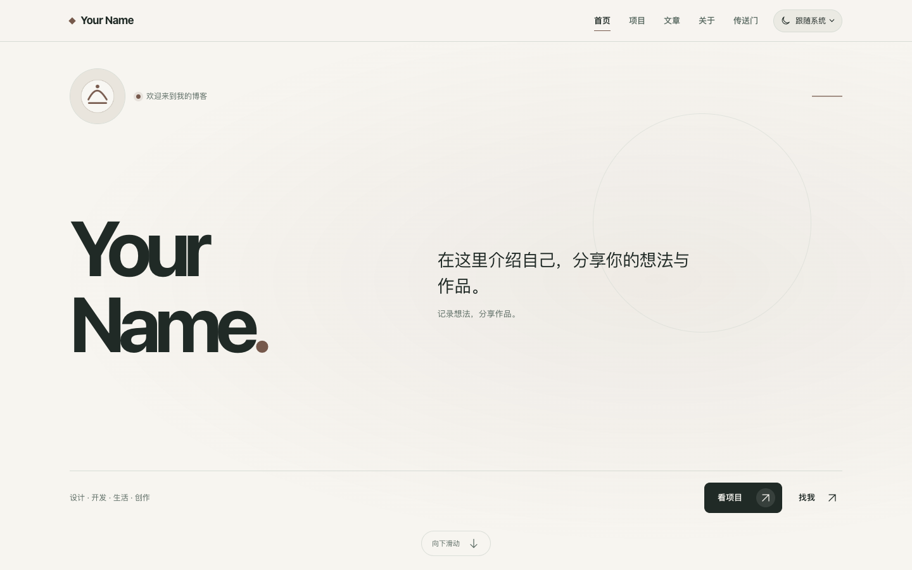

# Folio

一个可自托管的博客与作品集，使用 Next.js、React 和 PostgreSQL。仓库只包含占位资料、一篇示例文章和一个示例项目；没有原站点的数据库、账号、上传文件或个人链接。



- Studio 管理文章、项目、独立页面、媒体、首页区块、导航、社交链接和外观。
- 明暗主题可手动切换，也可以跟随系统；站长可以调整默认主题、强调色、字体和背景。
- 评论需要在 Studio 审核后才公开；文章浏览数是近似计数，同一标签页每篇文章 30 分钟内最多计一次。
- 支持 QQ、微信、微博、哔哩哔哩、GitHub、Telegram、Discord 等社交类型，也支持自定义链接和二维码媒体路径。

## 本地运行

需要 Node.js 22（最低 20.9）和 PostgreSQL。先创建一个空数据库，然后：

```bash
npm ci
cp .env.example .env
# 编辑 .env：填入数据库地址、站点地址、邮箱和密码，并设置随机认证密钥
npm run db:migrate
npm run db:seed
npm run owner:create
npm run dev
```

Windows PowerShell 可以用 `Copy-Item .env.example .env` 创建环境文件。可用 `openssl rand -base64 32` 生成 `BETTER_AUTH_SECRET`。打开 <http://localhost:3000>；登录地址是 `/studio/login`。`owner:create` 只在初始化时运行一次。

`db:seed` 只在首次初始化时加入示例内容；删除示例后再次运行不会重新添加。没有数据库时，网站展示默认资料和示例项目；文章、评论和 Studio 需要数据库。

## 自定义

登录 Studio 后，在「网站」中更改站点名称、个人资料、主题、背景、导航、社交链接和首页区块。可调整中间区块顺序；首屏、传送门和页脚位置固定。当前没有任意拖拽页面设计器；其他结构可通过源码修改。

在「内容」中编辑或删除示例文章与项目，创建独立页面、管理媒体和审核评论。`public/avatar.webp` 和 `src/app/icon.png` 是无个人信息的占位图，可替换；Studio 上传的媒体存储在数据库中。

首次配置的默认值位于 `src/lib/defaults.ts`，系统变量示例位于 `.env.example`。`GITHUB_TOKEN` 可选，启用后用于 GitHub 贡献数据。不要把 `.env`、数据库备份或真实令牌提交到仓库。

## 生产部署

设置 `DATABASE_URL`、`BETTER_AUTH_SECRET`、`BETTER_AUTH_URL`、`NEXT_PUBLIC_SITE_URL` 和所有者邮箱。站点与认证 URL 应指向实际域名。先备份数据库，再运行 `npm run db:migrate`、`npm run build` 和 `npm run start`。使用 nginx 等反向代理，并持久化和定期备份 PostgreSQL。

旧版 `/uploads/` 图片可在原文件仍存在时运行 `npm run media:backfill` 迁移到数据库。评论采用审核机制和基本速率限制；如站点面向大量公开流量，请按部署环境配置反向代理的限流和备份。

## 检查

```bash
npm run typecheck
npm run lint
npm run build
```

项目使用 Apache License 2.0，详见 [LICENSE](LICENSE)。
